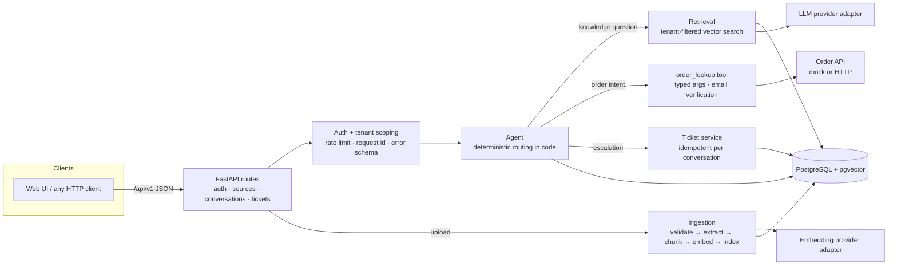

# Resolve AI

AI customer-support automation for e-commerce, built from the *Resolve AI SRS v1.0*.
It answers questions **only from a business's approved documents** (RAG with citations and a safe fallback),
looks up order status through a **verified, read-only tool**, and **escalates to a human ticket** when it can't help.

**Stack:** Python 3.11+ · FastAPI · PostgreSQL + pgvector · SQLAlchemy 2 + Alembic · one swappable LLM/embedding provider · Docker · pytest

---

## Quick start

### Option A - Docker (PostgreSQL + pgvector)
```bash
cp .env.example .env
echo "JWT_SECRET=$(openssl rand -hex 32)" >> .env      # required
docker compose up --build -d
docker compose exec api python -m app.cli seed-demo --password 'choose-a-password'
open http://localhost:8000          # chat + admin UI      ·  http://localhost:8000/docs  = OpenAPI
```

### Option B - local, no Docker (SQLite, fully offline)
```bash
python -m venv .venv && source .venv/bin/activate
pip install -r requirements-dev.txt
python -m app.cli seed-demo --password 'choose-a-password'      # creates ./resolve.db
uvicorn app.main:app --reload
```
SQLite mode is for development/tests (vectors stored as JSON, searched in Python). PostgreSQL uses pgvector's `<=>` operator.

### Demo script
Open the UI, keep tenant `demo-store`, click **Start chat**:

| Say | You'll see |
|---|---|
| "How many days do I have to return an item?" | Grounded answer + *Return Policy* citation |
| "Do you sell laptops with 32GB RAM?" | Fallback - no guessing, offers a human |
| "Where is my order?" → `ORD-1001` → `alice@example.com` | Asks for each missing item, then a verified status from the order API |
| `ORD-1001` + `bob@example.com` | Same generic "couldn't verify" reply as a non-existent order (no leak) |
| `ORD-9999` + any email | Simulated order-API outage → explicit failure, never an invented status |
| "I want to talk to a human" | Ticket created, conversation marked `escalated` |

Admin tab: sign in as `admin@demo-store.test` (the password you seeded) to upload/delete sources, watch ingestion status, view conversations and update tickets.

---

## Architecture



**Design decisions that matter**
* **Code decides, the model words.** Routing (escalate / order / knowledge) and tool permissions live in application code. The LLM only phrases an answer from retrieved passages, so a document or customer message can't grant itself tools or permissions.
* **Evidence threshold.** If no passage scores above the threshold the system abstains and offers clarification/escalation instead of answering (FR-014).
* **Order privacy.** An order is returned only if the supplied checkout email matches. "Not found" and "wrong email" produce *identical* replies (no enumeration), and lookups are capped per conversation.
* **Tenant isolation everywhere.** Tenant comes from the authenticated principal / DB row, never from client input. Other tenants' records return `404`, indistinguishable from missing. Retrieval filters on `tenant_id` in SQL.
* **Atomic indexing.** A source is chunked + embedded fully before any chunk is stored; failures mark it `failed` with an actionable message and leave nothing half-indexed.
* **Idempotent escalation.** `UNIQUE(conversation_id)` on tickets: retries/concurrency never create duplicates.

### Layout
```
app/
  api/        routes (auth, sources, conversations, tickets, health)
  services/   ingestion · retrieval · agent · orders · tickets · conversations
  providers/  base interfaces · mock (offline) · openai_compat · prompts
  models.py schemas.py security.py errors.py middleware.py logging_config.py cli.py main.py
  static/     single-file accessible web UI
alembic/      migration 0001 (enables pgvector)
sample_data/  3 demo FAQ documents
tests/        85 tests incl. the 30-case RAG set (tests/data/rag_eval.json)
```

---

## API (all under `/api/v1`, interactive docs at `/docs`)

| Method & path | Purpose | Access |
|---|---|---|
| `POST /auth/login` | Staff login → JWT | public, rate-limited |
| `POST /sources` · `GET /sources` · `GET /sources/{id}` · `DELETE /sources/{id}` | Knowledge sources | admin |
| `POST /conversations` `{tenant}` | Start chat → `access_token` for that conversation | public (slug), rate-limited |
| `GET /conversations` · `GET/PATCH /conversations/{id}` | Review / set status | staff (own tenant) |
| `GET /conversations/{id}/messages` | History (paginated) | that customer, or staff of the tenant |
| `POST /conversations/{id}/messages` | Send a message, get the reply | that customer only |
| `POST /conversations/{id}/escalate` | Create/link ticket | customer or staff |
| `POST /conversations/{id}/messages/{mid}/feedback` | 👍/👎 | customer or staff |
| `GET /tickets` · `GET/PATCH /tickets/{id}` | Tickets | staff; customer may read own |
| `GET /health` | Liveness + DB check | public |

Reply shape (SRS 5.4, plus a few fields): `answer, status, answer_type, sources[], escalation_available, conversation_status, ticket_id`.
`status` ∈ `answered | fallback | needs_info | order_result | tool_error | escalated | unavailable`;
`answer_type` ∈ `document | order_api | system` (document-grounded vs. API-derived is always distinguishable).
Errors always look like `{"error": {"code", "message", "request_id", "details?"}}`.

---

## Configuration
Everything is environment-driven - see `.env.example`. Highlights:

| Variable | Notes |
|---|---|
| `DATABASE_URL` | `postgresql+psycopg://…` (prod) or `sqlite:///…` (dev) |
| `JWT_SECRET` | **Required** outside SQLite dev - the app refuses to start with the default |
| `LLM_PROVIDER` / `EMBEDDING_PROVIDER` | `mock` (offline, deterministic) or `openai` (any OpenAI-compatible API: set `OPENAI_API_KEY`, `OPENAI_BASE_URL`, models) |
| `EMBEDDING_DIM` | Default 1024. **Fixed when you migrate** (`vector(1024)`); changing it needs a new migration + re-index |
| `RETRIEVAL_MIN_SCORE` | Unset = provider default (mock 0.18, openai 0.30). Tune against your own data |
| `CHUNK_SIZE`, `CHUNK_OVERLAP`, `RETRIEVAL_TOP_K`, `MAX_UPLOAD_BYTES` | RAG / upload limits |
| `ORDER_API_MODE` | `mock` (sample orders) or `http` + `ORDER_API_BASE_URL` (`GET /orders/{id}?store=<slug>` → `{email,status,carrier,tracking,eta,items}`, 404 if absent) |
| `CONVERSATION_RETENTION_DAYS` | `0` = keep; otherwise run `python -m app.cli purge-conversations` on a schedule |

Create a real tenant: `python -m app.cli create-tenant --name "Acme" --email you@acme.com --password '…' [--role operator]`.

## Testing
```bash
pytest                                   # 85 tests, offline, ~15 s (SQLite)
TEST_DATABASE_URL=postgresql+psycopg://user:pw@localhost:5432/resolve_test pytest   # same suite on real pgvector
```
All LLM/embedding/order calls are mocked or deterministic (NFR-007). `tests/data/rag_eval.json` is the version-controlled 30-question set from SRS 9.1
(10 answerable · 5 paraphrased · 5 follow-ups · 5 unanswerable · 5 adversarial/ambiguous), run end-to-end through the API.

---

## SRS traceability

| SRS | Where implemented | Verified by |
|---|---|---|
| FR-001 auth | `deps.py`, `api/auth.py`, `security.py` | AC-01 tests |
| FR-002 / FR-024 tenant isolation | `deps.load_conversation`, tenant filters in every route + SQL retrieval | `test_isolation.py` (AC-05) |
| FR-003/004/005 upload, validation, extraction | `services/ingestion.py`, `api/sources.py` | `test_auth_sources.py` |
| FR-006/007 chunking, embedding, indexing | `services/ingestion.py`, `models.DocumentChunk` | `test_units.py`, upload tests |
| FR-008 source lifecycle | `api/sources.py` | AC-02, AC-10 tests |
| FR-009/010/023 conversations, persistence, status | `api/conversations.py`, `services/conversations.py` | `test_conversations_errors.py` |
| FR-011/012/013/014 RAG, grounding, citations, fallback | `services/retrieval.py`, `agent.py`, `providers/prompts.py` | RAG eval set, AC-03/04 |
| FR-015 conversation context (P1) | `agent._passages_with_evidence` | follow-up cases F01-F05 |
| FR-016/017/020 order tool, access control, failure | `services/orders.py`, `agent._order_flow` | AC-06/07/08 tests |
| FR-018/019 tickets, escalation | `services/tickets.py` | AC-09 tests |
| FR-021 validation, consistent errors | `errors.py`, pydantic schemas | AC-11 test |
| FR-022 rate limiting (P1) | `middleware.SlidingWindowLimiter` | rate-limit test |
| FR-025 provider abstraction (P1) | `providers/` | unit tests with mocked HTTP |
| FR-026 feedback (P1) | `POST …/feedback` | feedback test |
| FR-027 structured logs, no secrets | `logging_config.py`, request middleware | log-redaction tests |
| NFR-002/003 graceful failure | agent + providers | LLM / embedding / order outage tests |
| §4.1 response rules, §8 prompt-injection | `prompts.py`, agent routing | injection tests |

---

## Known limitations (honest list)
* **Mock providers are not semantic.** The offline embedder is a hashed bag-of-words: great for deterministic tests, but paraphrase recall is weak (the "paraphrased" eval cases keep some lexical overlap for that reason). For realistic quality set `EMBEDDING_PROVIDER=openai`, `LLM_PROVIDER=openai`, re-tune `RETRIEVAL_MIN_SCORE`, and re-run the eval set. The OpenAI adapter is tested against a mocked HTTP transport only - it has **not** been run against the live API.
* **Intent routing is rule-based** (regex) so behaviour is predictable and testable; unusual phrasings of "where is my order" may miss. A model-proposed tool call validated by the same typed schema is the natural upgrade.
* **Scanned/image-only PDFs** are rejected (no OCR). Passwords on PDFs are not supported.
* **Rate limiting is in-memory** (single process). Use a shared store (Redis) or a gateway when running several replicas.
* **Background ingestion** uses FastAPI background tasks (lost if the process dies mid-job; the source stays `processing`). Move to a queue for large corpora.
* **No ANN index** on vectors (exact search is fine for demo scale); add HNSW for large corpora (see migration note).
* **Customer identity** is a per-conversation bearer token; order verification relies on order id + checkout email. Add real customer auth/OTP before production.
* Not production-certified; no SLA claims (per SRS §2.4 and §11).
